# [Deep Learning OFDM Modulation and Demodulation]Deep-Waveform: A Learning OFDM Receiver Based on Deep Convolutional Networks[with code]

Abstract: Discrete Fourier Transform (DFT) / Inverse Discrete Fourier Transform (IDFT) is generally considered the fundamental principle of Orthogonal Frequency Division Multiplexing (OFDM) systems. This paper proposes a Deep Convolutional Network with Complexity O(N^2), DCCN, for recovering bits from time-domain OFDM signals without relying on any explicit DFT/IDFT. DCCN can utilize the cyclic prefix (CP) of an OFDM waveform by replacing DFT with learned linear transformations to increase SNR and combines the advantages of utilizing CP, channel estimation, and Intersymbol Interference (ISI) suppression.Numerical experiments demonstrate that the DCCN receiver outperforms traditional channel estimators and conventional CP-enhanced techniques based on ideal and approximate linear minimum mean square error (LMMSE) estimation in Rayleigh fading channels with varying delay spread and mobility. The proposed method benefits from the expressive characteristics of complex value neural networks, yet it currently lacks support from popular deep learning platforms. In response, guidelines for the precise and approximate implementation of complex value convolution layers for the design and analysis of convolutional networks for wireless PHY are provided. Additionally, a new set of training techniques is developed to enhance the convergence and generalization capabilities of training models in fading channels.This work demonstrates the capability of deep neural networks to process OFDM waveforms, and the results indicate that FFT processors in OFDM receivers can be replaced by hardware AI accelerators.
I. Introduction
Recently, deep learning has been explored for the physical layer (PHY) of wireless communication for various tasks [1]-[3], including signal classification [4], [5], parameter estimation [5]-[9], channel estimation [8]-[20], channel coding [16], [21], [22], detection [11], [16], [23]-[26], modulation constellation design [7], and pilot design [27], [28]. Deep neural networks (DNNs) can not only enhance certain functionalities and components of wireless PHY but also be developed into an end-to-end novel communication architecture, which is considered as an autoencoder (AE) [6]-[8], [17], [21], [22].In place of seeking compact embeddings of structured data, such as in images and text (top of Figure 1), communication AEs (bottom of Figure 1) generate redundant representations of unstructured data. After being corrupted by a noisy channel, the original information can be recovered with bits. Communication AEs learn the behavior of the channel through self-supervised learning of a set of random bits as training data, learning from the structure of the data. On top of PHY, deep learning is also used for resource allocation and network management, such as traffic prediction [29], interference alignment [30], power control [31], spectrum sharing [32] and scheduling [33].
Deep learning data-driven methods offer several advantages to wireless PHY: i) achieving synergistic effects of combinational cascade modules in the signal processing chain [6], [7], ii) reducing mismatch between the underlying model and reality, iii) utilizing DNNs for constructing low-complexity solutions [11], [16], [25], [26], and iv) discovering irregularities and/or adaptive designs, such as for pilot design [27], [28] and modulation constellations [6], [7].
Compared to image or text interpretation, one of the main differences in wireless communication is the reliance on the representation of wireless signals in complex domain C. However, currently, deep learning for wireless PHY lacks support for complex value neural networks (CVNN), an emerging field within machine learning disciplines, originating from popular platforms such as TensorFlow [36] and Keras [37]. Conversely, existing research separately handles the real and imaginary parts of complex valued tensors, for example, by approximating D: two parallel real-valued tensors [7], [11], [16], or by approximating C: two channels of a real-valued tensor [28].However, the multiplication operation between the domain C and R2 space is different from that of R2. Without considering the multiplication operation, it may hinder the DNN from fully utilizing the real and imaginary parts of signal samples in terms of phase and amplitude, leading to increased complexity, reduced performance, and limited interpretability.
Figure 1. General Autoencoder (top) and Communication Autoencoder.
For example, in an Orthogonal Frequency Division Multiplexing (OFDM) system, it is required to have (inverse) Discrete Fourier Transform (DFT/IDFT) and/or Linear Finite Impulse Response (FIR) filters defined in the complex domain C. Without a complex value representation, existing deep learning-based OFDM receivers [8], [10], [11], [13]-[16], [23] and AE [8] are limited to relying on DFT/IDFT when processing OFDM waveforms. Regarding technical solutions, Convolutional Neural Networks (CNN) [4], [5], [16], [23], [24], [28] have a lower frequency of use in wireless PHY compared to Multilayer Perceptrons (MLP) [6]-[12], [21]-[22], [25], although their efficiency is higher. Due to the assumptions made by CNNs on underlying processes, it is more difficult to design operations for complex domains.
In this paper, we propose the design of a Deep Complex Value Convolutional Network (DCCN) to recover bits from synchronized time-domain OFDM signals. The developed end-to-end OFDM receiver does not rely on DFT/IDFT but learns a new method to receive OFDM waveforms with improved Signal-to-Noise Ratio (SNR), indicating the potential of deep learning for OFDM waveforms. The DCCN receiver outperforms traditional receivers in Rayleigh fading channels with lower complexity, leveraging recent advances in CVNN. Moreover, based on domain knowledge and OFDM frame structure, many structural and hyperparameter dimensions of DCCN are selected, providing a portable design template for other waveform structures.
The main contributions of this paper include: 1) Proposing a learning linear transformation that utilizes its cyclic prefix (CP) to replace DFT/IDFT processing for OFDM signals, improving the signal-to-noise ratio of OFDM signals. The results demonstrate that a new hardware accelerator can potentially replace the FFT processor in an OFDM receiver, and we prove the potential of CVNN in learning communication waveforms. 2) We also designed a data-driven interpretable DCCN channel equalizer, achieving performance superior to traditional receivers with O(N2) complexity by combining CP with [38]-[42], intersymbol interference (ISI) mitigation, and channel estimation.3) We have proposed a set of training methods to enhance the convergence and generalization capabilities of DNN-based receivers in fading channels, including a transfer learning scheme that trains the basic OFDM demodulation and channel equalization in two stages. The model is set up with white noise and fading channels at different SNR values, and the mixed Rayleigh fading model is used to smooth the training loss landscape for training and evaluation. 4) As far as we know, DCCN is the first deep neural network-based wireless receiver that employs explicit complex value representations across both the IQ domain. Libraries for complex-valued dense layers and convolutional layers are provided in open-source software [43], and guidelines for using real-valued neural networks on complex-valued tensors are also available to the community.
The rest of this article is organized as follows: Section 2 discusses the related work. In Section 3, an overview of OFDM systems and channel estimation methods is provided. In Section 4, the design and training methodologies for DCCN receivers are discussed. Finally, in Section 6, conclusions and future directions are discussed.
II. Related Work
A. Deep Neural Networks for Wireless Communications
MLP does not make any assumptions about the underlying processes and is used for channel estimation [9]-[12], detection [25], communication AE [6]-[8], [21], [22]. In these studies, MLPs typically have 3 to 5 layers and follow two configurations in the signal path. The first configuration is a direct path: at the receiver (transmitter), MLP receives data and pilot (input bits) and outputs an estimate of the transmitted symbol or soft bit [7], [8], [11], [25], [26] (transmit IQ samples [6]-[8], [22]). Other components may include for synchronization in AE [6]-[8], [22].The second configuration is an estimator: the MLP estimates the channel [9], [10], [12], [19] or other parameters [7], [9] using received pilots or signals, and operates similarly to a traditional system in recovering signals independently. In this paper, the DCCN developed employs an estimator configuration with four layers of MLPs interposed between convolutional layers for channel estimation.
CNN is used for signal classification [4] and restoration [5], channel estimation [16]-[18], [20], [28], [44], [45], and detection [16], [24]. Although CNN may not outperform MLP [21], it is more effective and scalable. For example, the OFDM receiver in [16] is based on a deep separable convolution with residual architecture to match a linear complexity LMMSE estimator. CNNs are also configured for direct paths in the signal path [16], [24] and estimator [44]. Other types of DNNs, such as Generalized Regression Neural Network (GRNN) [12] and Long Short-Term Memory (LSTM) [14], [17] are also used for channel estimation, and model-based DNNs expand iteration algorithms [23] for detection.
CVNN was discussed in [34] and [35], but it has not yet been supported by popular platforms [36] and [37]. [35, Page 1] points out that CVNN is "marginalized due to the lack of components". In wireless PHYs, most CNNs are real-valued [4] to [28], except for amplitude-phase representations realized with a single-layer complex convolution in [5], which requires additional phase (de)wrapping in many applications. Based on the analysis in Section IV-A, the expressive nature of CVNN can be represented by MLPs and CNNs, which retain [16] and [28] with appropriate input formats and dimensions, such as the number of receive fields and filters.However, the lack of discussions on these settings makes it difficult to scale the success of CNNs in terms of system parameters (including number of antennas and DFT size) [16], [28] or apply these experiences for future work. In this work, guidelines for implementing complex-valued convolutional layers are provided, and CVNN is used throughout the IQ domain.
B. OFDM System and Its Enhanced Channel Estimation
OFDM is the most popular system in modern wireless networks. In [46] and [47], the physical layer of OFDM and various channel estimation methods are introduced. At the transmitter side, several enhanced waveforms have been introduced into the OFDM family, such as filter bank multicarrier (FBMC) for 5G and next-generation communication systems, UFMC, and GFDM [48]. These modified OFDM waveforms generally have better characteristics regarding various interferences. The constellation enhancement method [49] and a deep learning (DL) based coding system [13] to reduce the peak-to-average power ratio (PAPR) of OFDM waveforms are proposed. A MLP-based channel estimator for FBMC shows good performance in high mobility channels [50].
Figure 2. Physical layer of an OFDM system: (a) Traditional OFDM PHY diagram [46], (B) An example OFDM coherent slot and time domain waveform [41].
Most improvements occur at the receiver end. As shown in Figure 2 (B), as part of the OFDM waveform, a cyclic prefix (CP) is introduced for receiver synchronization and ISI reduction. The CP has been used to enhance blind [39]-[42] and pilot-aided [38] channel estimation by improving SNR, frequency selectivity, and interference mitigation. In [38], the decoding data from the previous OFDM symbol is used to recover the CP for the next symbol. However, the method in [38] can only enhance LS channel estimation. Our model accomplishes this task by processing multiple OFDM symbols simultaneously, achieving better overall performance with slightly improved efficiency without explicit algorithms, which complements analytical methods such as maximum likelihood [39], [41], and factor graphs [40], [42] in utilizing the CP.
DNN is also used to enhance OFDM receivers. In [11], a 5-layer MLP is employed for channel estimation and symbol detection. Our work confirms the conclusions in [11] that an MLP can match MMSE under high SNR and outperform MMSE in handling adversities related to CP, clipping noise, and channel mismatch. Unlike [11], our channel estimator is linearly activated instead of using ReLU, thus representing a low-rank approximation of LMMSE. The MLP in [11] handles OFDM waveforms without CP, whereas our model uses CP to simultaneously improve SNR and mitigate ISI.Furthermore, in [11], it is required to train an independent MLP for each 16-bit segment, whereas we use a single model to process the entire coherent slot, thereby achieving better scalability. Many studies have used CNNs for channel estimation in OFDM systems [18], [20], [44], [45], but they cannot outperform the ideal LMMSE. However, for large-scale MIMO, low-complexity channel estimators that can outperform the approximate LMMSE are still attractive [18]. The OFDM receiver in [16] achieves linear complexity O(N), but it only matches the ideal LMMSE on the training channel model and performs poorly with invisible channel models.Compared to these studies, our DCCN outperforms the ideal LMMSE in complexity only O(N2), even with an invisible channel model. In [19], a MLP-based channel estimator for non-OFDM systems outperforms the approximate LMMSE in dual selective channels and exhibits better robustness against mobility, findings confirmed in our work despite not being directly comparable. In [14], Long Short-Term Memory (LSTM) is used to estimate the channel by predicting future data, and it is reported to outperform LMMSE in high-speed scenarios. In contrast, our method alleviates ISI by processing multiple OFDM symbols simultaneously.Deep learning has been proven to improve MIMO detection [23]-[25] and channel coding [17], while this paper only considers single-antenna. Furthermore, the aforementioned works [8], [10], [11], [13]-[16], [23] all rely on explicit DFT/IDFT, which are replaced by our learned linear transformations in our method to enhance SNR. Our work first demonstrates the capability of DNNs to process OFDM waveforms, and we provide a transferable design template for other waveform structures based on the OFDM frame structure and the method of setting NN layer hyperparameters leveraging domain knowledge.
III. OFDM Communication Systems
\tWe first introduced the related concepts and symbols in the traditional OFDM system at a lower physical layer, followed by the channel estimation method in the traditional receiver.
The block diagram of the PHY for OFDM systems is shown in Figure 2 (a). At the transmitter, channel coding is applied to the input bits b ∈ {±1} for error detection and/or correction. The encoded bits are then converted into complex valued IQ data by mapping onto a constellation on the IQ plane. Training signals (pilot) and guard bands are inserted into the IQ data to create the frequency domain OFDM symbol X, which is then transformed into the time domain OFDM symbol x via N-point IDFT and subsequent parallel to serial (P/S) conversion. Next, CP (partially before x) is prepended to x to create the time domain full OFDM symbol xcp, as shown in Figure 2 (b).Subsequently, the baseband signal xcp is upconverted to RF and transmitted through the RF frontend in the air. The radio signal propagates over the wireless channel and is picked up by the receiver frontend and downconverted into baseband IQ samples. At the receiver, the received time-domain OFDM symbol ycp is recovered by a carrier synchronization block. Then, the CP from ycp is removed, and the remaining IQ samples y are transformed into frequency domain OFDM symbols Y via DFT. Based on Y, the channel equalizer outputs the estimated transmit frequency domain IQ data X, which is then demodulated into soft bits (log-likelihood) Xib, and converted into binary output bit Xib by a channel decoder. Finally, B layer passes to the next layer.Please note that the focus of this article is on the lower physical layer, and channel coding is not discussed. We refer to the frequency domain and time domain in Figure 2 (a) as IQ domain, where signals are represented by complex-valued samples.
Figure 3. The impact of different wireless channels on QPSK modulation, SNR = 6 dB, IQ plane (x: in-phase, y: quadrature).
\tOFDM systems typically have a frame structure, where the coherent slots (or simply "slots") consist of multiple OFDM symbols as shown in Figure 2(b). The symbols associated with the coherent OFDM slots are as follows: an OFDM symbol contains N subcarriers, where N is the size of the DFT/IDFT. In the N subcarriers, G out of the total number of FRF subcarriers are placed at the center (DC guard band) and edges (edge guard bands). The subcarriers within an OFDM symbol are referred to as resource elements (RE). A coherent slot consists of F consecutive OFDM symbols, with P REs and D REs assigned to pilots and data, respectively. The length of a time-domain full OFDM symbol is S = N + Ncp, where Ncp is the length of the guard interval. Under m-ary modulation, IQ samples carry m bits, and the constellation size is 2m.
B. Wireless Channels
\tA widely accepted simplified model for wireless channel descriptions includes fading and noise processes [46]:
where x, y, no ∈ CSF×1 denote the time-domain transmitted and received signals and white noise, h ∈ CL×1 represents the channel impulse response, X, Y, H, No ∈ CN×F are the frequency-domain transformations of x, y, h, and no, respectively, such as X = DFTN(x), and xN and xN are the operators for convolution and element-wise multiplication. Without loss of generality, (1) can also refer to an OFDM symbol, i.e., x ∈ CN×1, xcp ∈ CS×1, and X ∈ CN×1.
\tMultipath fading can be modeled as a linear finite impulse response (FIR) filter:
Among them, zk is a complex random variable, vector τ and τ represent the power delay distribution (PDP) of the fading process, Ts is the sampling period for discrete signals. The filter length L is chosen such that |HL| when l < 0 or l ≥ L, the real and imaginary parts of zk are independent and identically distributed for Rayleigh fading. Gaussian random variables, thus |ZK|2 follows a Rayleigh distribution. K is the number of paths in the multipath fading channel. In a flat fading channel with K = 1, all subcarriers in an OFDM symbol have the same channel coefficients. In a multipath fading channel, K > 1, the channel coefficients vary with subcarriers, resulting in frequency-selective channels. The impact of different fading processes on the frequency domain IQ samples is shown in Figure 3. Note that only noise and fading are considered, while channel coding's effects on the channel degradation are left for future work.
The channel impulse response h is time-varying, and its coherence time Tc is inversely proportional to the maximum Doppler frequency Fd, i.e., Tc < 1/Fd. OFDM systems are typically configured based on their application, measured coherence time Tc, coherence bandwidth Bc, and total bandwidth, so that slow fading can be accommodated in coherent slots.
Figure 4. Typical OFDM pilot pattern: comb, block and scattering.
C. Channel Estimation and Equalization
Considering communication systems with pilot-aided channel estimation at the receiver. As shown in Figure 4, different pilot modes such as block, comb, and distributed pilots are designed to sample channel distortion. The pilot signal is a constant signal or low autocorrelation sequence (e.g., Zadoff-Chu sequence). The basic pilot-aided channel equalizer in OFDM systems is based on the Least Squares (LS) estimator [46], [47]:
Among them, X^ is the estimated signal, H^LS is the signal containing LS channel estimation, XP and YP are respectively the pilots for transmission and reception, and F(·) is an interpolation operator, such as linear, spline, low-pass filter, and DFT [46], [47]. The LS estimator is statistically indeterminate for the channel, while other estimators, such as LMMSE, maximum likelihood, and parameterized channel modeling (PCMB) estimators, are based on the LS estimate and/or prior channel knowledge [46], [47].
The ideal LMMSE estimator is represented as [47], [52]:
In this context, RHH = E{H*,i, HH*,i} represents the frequency domain covariance matrix of the channel implementing H. α is the linear domain SNR, and β is a constant defined based on a specific modulation scheme. The ideal LMMSE estimator in (4) requires prior knowledge of the channel RHH and α, which is not available in practice. Additionally, the matrix inversion in (4) leads to O(N3) computational complexity. The low-rank approximation (LRA) of LMMSE [53] approximates the ideal LMMSE matrix RHH (RHH + βαI)−1 through singular value decomposition (SVD) of the specified α and RHH, allowing for PDP mismatches while achieving lower O(N2) complexity at the cost of an unresolvable error floor.Approximate LMMSE (ALMMSE) improvements include the use of different PDPs [54], SNR estimation [52], [55], rank estimation, and leveraging the cyclic properties of the LMMSE matrix [52]. The ALMMSE can be further reduced in complexity to O(N) by precomputing an LMMSE matrix, albeit at the cost of performance degradation within a specific SNR range [56].
Figure 5. DCCN OFDM receiver flowchart: The DCCN equalizer converts the time-domain received signal ycp into an estimated transmitted signal xcp, which is then converted by the DCCN basic receiver into an estimated soft bit xcp and hard bit xcp. Blue represents the complex value domain, gray represents the real value domain. The dimensions and data types of the dense layers are shown as, for example, CS×N, with the output tensor shape being, for example, [B, F, N]. The dimensions of the convolutional layer are marked next to the block, such as N×N×1 indicating an N-dimensional one-dimensional filter with a length of N. The dashed block represents the data tensor.
IV. DCCN-based OFDM receiver
The OFDM receiver based on DCCN is represented by the function b~ = DS(ycp;Θ), which is defined over a set of hyperparameters S for the configuration of the OFDM frame and the DCCN stream graph (Figure 5). Here, b is the log-likelihood of transmitted bits, ycp is an OFDM symbol received in a synchronization time domain slot including a CP, and Θ is a set of trainable parameters for the DCCN. The OFDM receiver based on DCCN includes a channel equalizer followed by a basic receiver. The hidden layer of the DCCN is named as a signal processing module in traditional OFDM receivers, but their functions may differ.Forward networks encapsulate signal processing in traditional receivers and ensure that the search space for Θ is at least as large as an ALMMSE receiver by adding computational redundancy. This can be minimized during training by introducing regularization losses. The structural redundancy is included in the flowchart for research purposes, and a simplified flowchart is proposed in Section V-E for deployment.
A. Guidelines for 1D Complex-Valued Layers
Figure 6. (a) Three implementations of a 1D complex-valued Convolutional layer (C-Conv) with dimensions 1 × 1 × 1, (b) An implementation of a 1D C-Conv layer based on a 2D real-valued Convolutional layer (16×(1,8)×1), and (c) A 1D C-Conv layer with dimensions 8×8×1.
The implementations omit biases and activations, and the complex-valued neurons can be represented as [34]:
where xIN, xOUT ∈ C and weights a, B ∈ R are the true real and imaginary parts of the complex weights. (5) Approximately, it can be treated as a dense layer with an approximate D input and trained weights w a-b b a. When generalizing to higher dimensions, we have the following principles:
Note 1. The dense layers with shape CZi×Zo always can be approximated as dense layers with sufficient expressive power R2 Zi × 2 Zo.
Note 2. A complex-valued convolutional layer (C-Conv) with size fn × fs × fc (representing the shape, fs, and depth offc of the fn filters) can be approximated as a real-valued Convolutional layer (for approximate D inputs) or 2fn×(fs,2)×fc (for approximate C inputs), without adhering to (5), and can be precisely implemented using a real-valued Convolutional layer (for approximate D inputs) with size 2fn×fs×fc.
By adhering to (5), the precise implementation of CVNN layers reduces unnecessary degrees of freedom and only requires approximating half the number of trainable real-valued weights required. More specifically, three example implementations for a 1D C-Conv layer with dimensions 1 × 1 × 1 are provided in Figure 6(a) to illustrate annotation 2. All three implementations satisfy the expressive requirements with the same computational complexity (four multiplications and two additions per complex sample). Each of the two approximate implementations requires four weights, while the exact implementation only requires two. The exact implementation has better spatial complexity and training efficiency, while also reducing the search space for the optimizer.For practitioners, if the approximate C-Conv layer does not meet the required input format or minimum size, its expressive power will be lower than that of the precise C-Conv layer, such as the shape and number of filters. For the principle of complex value activation, we invite readers to refer to [34] and [35].
Figure 7. DCCN training system block diagram.
In Figure 6 (B), the implementation of our DFT class C-Conv layer is illustrated through an example of a 1D C-Conv layer with size 8×8×1 implemented using a 2D real-valued Convolution layer with size 16×(1, 8)×1. In this work, the real and imaginary parts of the complex tensor are on the last dimension.
B. Basic DCCN receiver
The basic DCCN receiver is an OFDM receiver without a channel equalizer, as shown in the right half of Figure 5. The forward network of the basic receiver starts with an optional slice for dropping the CP, followed by a C-Conv layer of size N × S × 1 (or N × N × 1 if dropping the CP), designed to convert the time-domain OFDM symbol into the frequency domain X and utilize the CP for SNR gain. Subsequently, a complex dense layer C FN×D is designed to extract all data RE × XD from one coherent slot. The remaining part of the forward network essentially consists of a classifier that converts IQ samples into soft bits, where the input IQ samples are treated as vectors of two real numbers, C∈R2.The extracted IQ vectors and their nonlinear (Leaky ReLU) activation A0 are connected to a tensor of shape [B, D, 4] and fed into a small dense layer with R4×2 m inputs, followed by another Leaky ReLU activation A1 whose output tensor is reshaped to [B, D, m, 2], then activated along its last dimension by the softmax function to produce likelihood vectors with soft bits ±1. B is the number of slots in a batch of input signals. Since channel coding is beyond our scope, the output bits are obtained through hard decisions on the soft bits. In Section V-E, variations of the forward network were tested.
C.DCCN Channel Expander
\tThe input of DCCN equalizer is ycp, and the output is xcp, which is pre-staged to the basic DCCN receiver as shown in the left half of Figure 5. The forward network of DCCN equalizer includes four submodules: the first submodule consists of CS×N (or CN×N, if CP is dropped) dense layers, followed by N×N×1 C-Conv layer that converts ycp into frequency domain Y. The second submodule estimates the channel frequency response H∞ with four dense layers, followed by a 2D complex filter. The third submodule performs equalization using element-wise complex division X = Y/H. Finally, X xcp is converted to xcp through an N×N×1 IDFT class 1D C-Conv layer, and xcp is recovered by adding CN×S dense layers with CP.
Figure 8 divides training into two stages for both the basic receiver and equalizer. In the channel estimation submodule, the first dense layer of CFFN×P is designed to locate pilots and estimate channel coefficients H P LS on the pilots. Then, H P LS is interpolated into the entire coherent slot and the channel estimation from three dense layers within the whole coherent slot and the size of (F,N) 2D filter, similar to LRA-LMMSE [53]:
\twhere Dp is a diagonal matrix, elements δk = λk λk+β/α (k ∈ [1, p]), δk = 0 (k ∈ [p + 1, N]), U is an unitary matrix containing RHH singular vectors. Instead of explicitly setting λ, p, α and U [52], [54], [55], (6) the LMMSE matrix is the trainable parameters to learn multiple dense layers from data. Note that these dense layers have coherent slots for ISI reduction. In Section V-C, our DCCN receiver also shows an error floor layer with specified SNR like ALMMSE [52], [53], [55]. Other number of CFFN×FN dense layers are tested in Section V-E.
The number of OFDM symbols per coherent time slot, F, is considered a constant in the protocol. The asymptotic computational complexity for DCCN receivers is O(N2) (or O(NS) for DCCN with CP), as DCCN consists of acascade of layers without any loops. The maximum complexity for 1D convolutional layers and fully connected layers is O(N2) (or O(NS) for CP). If F is considered a variable, the complexity is O(N2F2).
D.2-stage training
The training setup for the DCCN receiver is shown in Figure 7. An online random generator creates a random binary stream b, which is converted into time-domain OFDM symbols as transmit signal xcp by the OFDM transmitter. The received signal ycp is created by adding fading and noise to x through the channel model. ycp and B are respectively the training data and labels. The output of the DCCN model is soft bits, and the output bits are generated by hard decisioning on the soft bits, loss function L(B, k B, k B, Θ) is the weighted sum of cross-entropy (CE) loss and regularization loss Lreg(Θ):
\twhere ε is a small constant far less than 1. Cross-entropy loss LCE(B, B) is the average cross-entropy between training label B and soft bit B. During training, the DCCN receiver's 0 are initialized randomly and updated by an Adam optimizer based on the loss function in (7), running backpropagation through the reverse pass.
Due to the severe distortion shown in Figure 3(c), it is difficult and perhaps impractical to train a DCCN receiver directly in a multipath fading channel. Consequently, a transfer learning scheme as depicted in Figure 8 has been developed to train both the basic receiver and equalizer in two stages. In stage 1, only the basic receiver is trained in an AWGN channel. In stage 2, the flow graph of the DCCN equalizer is first pre-forwarded to the pretrained basic receiver in a dedicated TensorFlow session for graph editing. Subsequently, the DCCN receiver is loaded and trained in another session where the trainable parameters of the basic receiver are frozen and the channel fading is incorporated to generate training data. The loss function remains the same in both stages 1 and 2.When the back half of the current network is frozen, graph editing techniques can be used for backpropagation. Note that two-stage training methods can improve data efficiency by reusing the same pre-trained basic receivers in stage 2 for different fading settings. Similarly, the training model from stage 2 can be fine-tuned for different real channels.
To enhance training efficiency, several techniques have been employed. Training data is fed to the model in small batches, leveraging the high throughput of parallel processing in GPUs and minimizing the delay due to memory copying. In the programming of an OFDM transmitter and fading module based on NumPy, data processing vectorization is utilized to avoid large loops. As training progresses, the learning rate exponentially decays to facilitate fine-tuning. Randomly generated training labels and corresponding training data are generated online instead of repetitively inputting pre-generated training datasets. Therefore, we use iteration rather than epoch (complete training over the entire dataset) to describe the outermost loop during training. If key performance metrics (i.e., BER) do not improve after a fixed number of iterations.
E. Channel Settings During Training
There is no explicit guidance for setting the SNR for training based on DL-PHY. We employ different SNR configurations in two stages. In the first stage, the signal-to-noise ratio does not affect the optimal basic receiver but training effectiveness. Noise in the channel causes bit errors, driving gradient descent and acting as a regularizer to prevent overfitting. A higher SNR requires larger batch sizes to produce the same number of bit errors, which may reduce data efficiency and prolong the convergence time of training. On the other hand, lower SNR may hide small decoding biases in relatively large BER, meaning that output bits always have more than -1. To this end, we recommend training SNR values for stage 1 to be Eb/No = 5 dB [21], specifically selecting SNR ηi = 5 m dB for m-ary modulation.
In Stage 2 of training, the optimal DCCN equalizer depends on channel statistics such as SNR and PDP. To enhance the generalization capability of the trained model, a hybrid of SNR and fading model is adopted. The SNR for each OFDM coherent slot is selected randomly from the working SNR mechanism based on a probability function that prefers high SNR values while not excluding medium and low SNR values. For example, ηi ∈ {0, 3, ..., 30}, where P(ηi ≥ 17) = 90%. The fundamental principle is that the DCCN equalizer is similar to the fast ALMMSE algorithm [52], designed for high SNR (i.e., 20 dB) rather than low SNR (i.e., 5 dB).At the same time, due to LMMSE's robustness to PDP mismatch, the DCCN equalizer will approach the optimal point for different PDPs. The hybrid of Rayleigh fading models not only enhances generalizability but also has a convergence time. The fade model with shorter delay spread can smooth out the overall loss landscape, helping the optimizer overcome local minima associated with fade models with richer multipath. In sections V-D and V-E, models trained using different channel settings in two stages are compared.
Table I. OFDM System Performance Evaluation
5. Evaluation Results
A. Methodology
1. In numerical evaluations, the DCCN receiver is compared with traditional receivers using different channel estimators [43]. The results of the basic DCCN receiver operating on an AWGN channel with m-ary orthogonal amplitude modulation (QAM) (m ≤ 4) are first presented, followed by the results of the DCCN receiver operating in a Rayleigh fading channel with different PDP, ISI leakage, and mobility settings for equalization. We use symbol DCCN and DCCN-CP to refer to the DCCN receivers without and with CP exploitation, respectively.
2. The OFDM system simulated in this evaluation is a simplified LTE downlink frame structure as detailed in Table I, where the DFT size is 64, there are a total of 16 SCs at both edges and the DC, with a sampling rate of 0.96 MHz, and subcarrier bandwidth of 15 KHz. The coherent slots include 7 OFDM symbols, with the number of REs allocated to pilots and data being P = 16 and D = 320, respectively. The pilot signal has a constant value of 1/2 (1 + i). QAM and Gray codes of orders 2, 4, 8, and 16 are used for constellation mapping, with the maximum constellation amplitude being 1. The peak-to-average power ratio (PAPR) of the OFDM waveforms after the transmitter is limited to 9dB.
The basic receiver and the training configuration with m-ary modulation for equalizers are listed in Table II. The batch size of a random gradient descent based Adam optimizer is 72 coherent slots. In each iteration, a new random bit stream (training labels) is generated and converted into training data through a traditional OFDM transmitter and channel model. Since the training labels are random, the loss function for early stopping is based on the training data rather than individual test datasets. Training either ends when the maximum number of iterations is reached or triggers early stopping, which typically occurs in practice. The learning rate is initially set to 0.001, decrementing by 2% every 500 mini-batches (steps) or 2.5 times external iterations. SNR is set according to the description in Section IV-D.Each external training iteration consists of 200 small batches, and the test data has 20,000 coherent slots for each SNR point from -10 to 30 dB. The Rayleigh fading used in the training phase 2 is set as a flat fading, EPA, Eva, and ETU alternating model in consecutive slots.
\tTrain the DCCN model for 250-1300 iterations, as shown in Figures 12 and 13. 9. The training process starts with rapid fitting, followed by a lengthy fine-tuning phase: cross-entropy first sharply decreases in the first 10-50 iterations, then slowly but steadily decreases until it reaches its lowest point. The source code can be found in [43].
B. Additive White Gaussian Noise Channel
Our basic receiver and traditional OFDM receivers [43] use BPSK, QPSK, 8-QAM, and 16-QAM modulation with a SNR of -10 to 20 dB in an AWGN channel as shown in Figure 10. Without the help of CP, we do not expect DCCN to outperform traditional demodulation, as the latter is optimal in an AWGN channel. For BPSK, 8-QAM, and 16-QAM, when the BER is below 10−5, the performance of DCCN is close to that of traditional receivers, with a difference that can be ignored (≤ 0.16 dB).However, for QPSK, DCCN starts to perform poorly at a BER of 10-2 and the gap increases to 0.7 dB when BER is 10-6. On the other hand, DCCN-CP consistently outperforms DCCN, with the gap decreasing from 0.7 dB in BPSK to 0.5 dB in 16 QAM. For QPSK, DCCN-CP starts to perform poorly at a BER of 10-6. Note that when BER is very small, such as ≤ 10-5, the relative error due to limited data size in the simulation increases.CP carries information on all subcarriers and experiences independent random noise, so theoretically it can increase the power of data signal by NcpD/(FN 2), which corresponds to an SNR increase of 0.75 dB for a CP length of 0.25N in AWGN channel. For BPSK, DCCN-CP makes the SNR of DCCN improve very close to 0.75 dB. The results show that using C-Conv layer to transform OFDM symbol from time domain to frequency domain has the advantage of utilizing redundant information carried by CP, which is not possible to achieve explicitly with DFT.
VI. Conclusion and Future Work
This paper proposes an end-to-end OFDM receiver--Deep Complex Convolutional Network (DCCN) to recover uncoded bits from a synchronized time-domain OFDM signal. DCCN employs complex domain multiplication rules instead of separating the real and imaginary parts of IQ sampling as separate streams, which can replace DFT/IDFT in OFDM systems and utilize the redundancy of cyclic prefixes in OFDM waveforms to improve SNR. Leveraging the expressiveness and synergy advantages of complex value neural networks, DCCN can integrate tasks such as CP development, LMMSE low rank approximation, and symbol inter-symbol interference suppression, thereby outperforming traditional LMMSE receivers and traditional CP enhanced channel estimation in dual selective Rayleigh fading channels with computational complexity O(N2).This work also provides transferable experience for similar tasks. It offers practical guidance for the approximate implementation of multi-value convolutional networks, particularly regarding the dimensionality of the convolutional layer in OFDM system parameter settings. A new training method for wireless transceivers based on deep learning has been developed, including a transfer learning scheme to prevent vanishing gradient problems during training, an end-to-end loss function that uses a hybrid SNR and fading model to smooth the loss landscape. It demonstrates the capability of deep neural networks to process complex communication waveforms and suggests that FFT processors in OFDM receivers could be replaced by hardware AI accelerators.
Possible future directions for recurrent neural networks include: 1) exploring nonlinear signal processing to achieve better performance and/or complexity, 2) enhancing scalability through channel estimation using convolutional layers, 3) extending to the spatial domain, such as large-scale MIMO, and 4) exploring waveform design and channel coding via communication autoencoders based on recurrent neural networks.

## Images

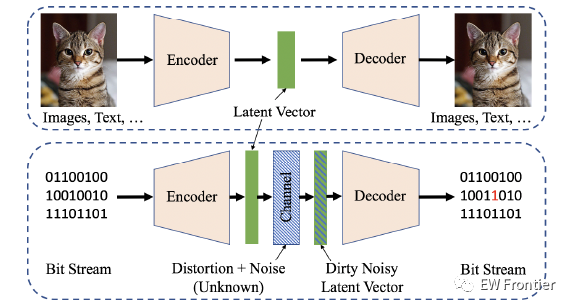
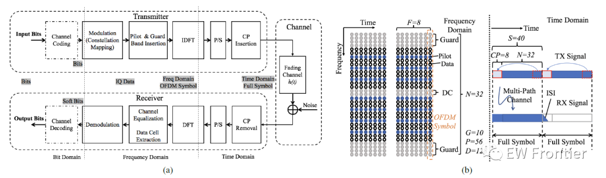
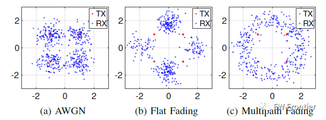
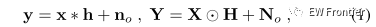
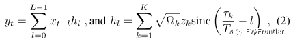
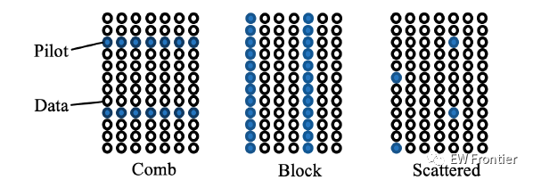
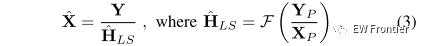
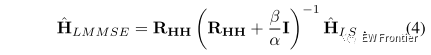
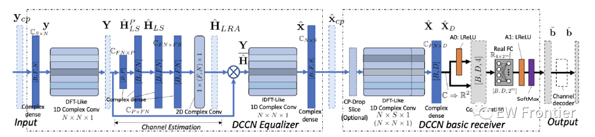
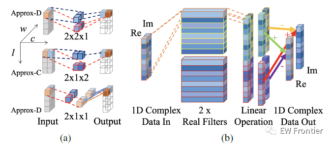
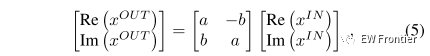
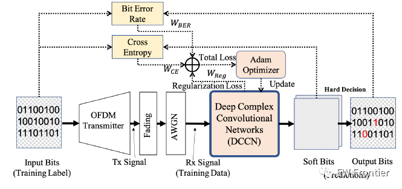
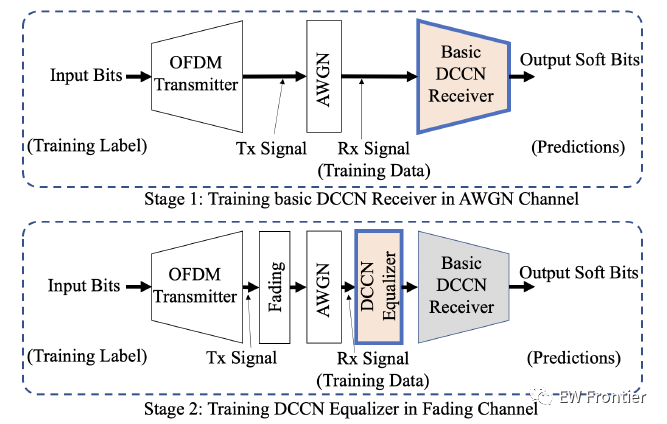
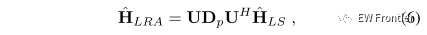
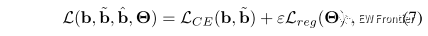
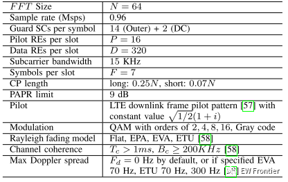

<!-- PAYMENT_BLOCK -->

## Get this dataset

- Payment link (Stripe): [Buy now](https://buy.stripe.com/3cs8yP7sY87d0vu9AB)
- Payment QR code: 

<!-- /PAYMENT_BLOCK -->
